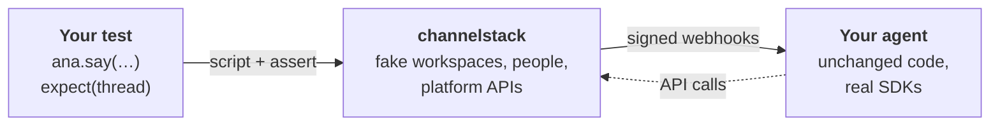

<p align="center">
  <a href="https://channelstack.dev">
    
  </a>
</p>

<p align="center">
  A test harness for the apps and agents you build for Slack, GitHub, Linear, Notion, Resend and Gmail.
</p>

<p align="center">
  <a href="https://channelstack.dev">Website</a> ·
  <a href="https://channelstack.dev/docs">Docs</a> ·
  <a href="#status">Status</a> ·
  <a href="CHANGELOG.md">Changelog</a> ·
  <a href="docs/phases.md">Build plan</a>
</p>

---

channelstack runs fake versions of Slack, GitHub, Linear, Notion, Resend and Gmail on your machine. It's for anyone whose code talks to those platforms' APIs and reacts to their events: a Slack bot, a GitHub App or Probot app, a Linear or Notion integration, an agent people email, a notification bot, or an AI agent. Tests script the people, your app answers through its real code path, and you assert on what a person would see:

```ts
test("a mention gets exactly one reply, in the thread", async ({ slack }) => {
  const ana = await slack.createUser({ name: "Ana" });
  const channel = await slack.createChannel({ participants: [ana, slack.app] });

  const msg = await ana.say("@my-agent summarize yesterday's incidents", { channel });

  await expect(msg.thread).toHaveRepliesFrom("my-agent", { count: 1 });
  await expect(channel).not.toHaveChannelMessageFrom("my-agent");
});
```

The same test in Python, with [pytest-channelstack](integrations/pytest-channelstack):

```python
from channelstack import SlackFixture
from pytest_channelstack import expect


async def test_a_mention_gets_exactly_one_reply_in_the_thread(slack: SlackFixture) -> None:
    ana = await slack.create_user(name="Ana")
    channel = await slack.create_channel(participants=[ana, slack.app])

    msg = await ana.say("@my-agent summarize yesterday's incidents", channel=channel)

    await expect(msg.thread).to_have_replies_from("my-agent", count=1)
    await expect(channel).not_to_have_channel_message_from("my-agent")
```

And in Rust, with the [channelstack crate](sdks/rust):

```rust
use channelstack::{Handle, Mode, connect, expect};

#[tokio::test]
async fn a_mention_gets_exactly_one_reply_in_the_thread() -> channelstack::Result<()> {
    let client = connect(Mode::Auto).await?;
    let session = client.open_session().name("a mention").send().await?;
    let slack = session.slack().await?;

    let ana = slack.create_user().name("Ana").await?;
    let channel = slack
        .create_channel()
        .participants(vec![&ana as &dyn Handle, &slack.app()])
        .await?;

    let msg = ana.say("@my-agent summarize yesterday's incidents").channel(&channel).await?;

    expect(&msg.thread()).to_have_replies_from("my-agent", 1).await?;
    expect(&channel).not_to_have_channel_message_from("my-agent").await?;

    session.close().await?;
    client.close().await;
    Ok(())
}
```

There are no hand-built webhook payloads and no mocked SDK calls. Ana posts, the fake Slack delivers a signed event to your app, your app replies through the Slack SDK it already uses, and the matcher waits for what Ana would see in the thread.

## Why

Apps that live in these platforms break in the gaps between systems: a webhook signed the wrong way, a payload shape that changed last month, a stray progress message nobody asserted on.

- **Your app's real code path.** `channelstack env` prints the URLs and tokens that point your app's own SDKs at `slack.localhost`, `github.localhost`, `linear.localhost` and `notion.localhost`. Apps that can't change their base URL send their traffic through channelstack's proxy instead ([proxy mode](docs/devx.md#9-proxy-mode-for-agents-that-cant-change-their-base-url)).
- **Shapes checked against the real platforms.** channelstack's own tests validate what the fakes send against the platforms' published schemas (GitHub, Linear) and against recorded real traffic where no usable schema exists (Slack). When a platform changes, channelstack's build goes red, instead of your tests passing against a stale fake.
- **People, not payloads.** Write `ana.click("Approve", { message })` instead of hand-building a `block_actions` body. People post, reply, review, delegate and press Stop, with correct signatures, retries and delivery ids.
- **Assert what people see.** Streams, status lines, edits and ephemeral messages render into one transcript. `toHaveRepliesFrom(…, { count: 1 })` catches the double post.

## Channels

Each channel is a fixture your test receives by name (`async ({ slack, github }) => …`). Use one, or several when your app spans them.

| Channel | In your test | What it fakes                                                                    |
| ------- | -------- | -------------------------------------------------------------------------------- |
| Slack   | `slack`  | DMs, mentions, threads, buttons and modals, streaming replies and the agent view |
| GitHub  | `github` | Apps and installations, issues and pull requests, reviews, check runs            |
| Linear  | `linear` | Teams, issues and comments, delegation, agent sessions, activities and Stop      |
| Notion  | `notion` | Pages and databases, comments and discussions, connections and webhooks          |
| Resend  | `resend` | Email to the agent and its answers in the thread, the receiving API, Svix-signed webhooks |
| Google  | `google` | A Gmail mailbox: messages, threads, labels, history and watch, Pub/Sub pushes with OIDC tokens |

The same tests can also run against the real platforms in sandbox workspaces ([live mode](docs/live-mode.md)).

## How it works



One server process fakes the platforms in memory. Your test drives it through a control API, it delivers what the platform would deliver, and your app talks to it as if it were the real thing. channelstack never starts or wraps your app. More in [docs/architecture.md](docs/architecture.md).

## Quick start

```bash
npm i -D channelstack
CHANNELSTACK_SLACK_WEBHOOK_URL=https://my-agent.localhost/slack/events npx channelstack &   # the fakes, each with an app named my-agent
npx channelstack env >> .env.local        # tokens and URLs for your agent
portless run my-agent pnpm dev            # your usual start command, reachable at https://my-agent.localhost
```

Add the plugin to your test runner and run your tests:

```ts
// vitest.config.ts
import { defineConfig } from "vitest/config";
import channelstack from "channelstack/vitest";

export default defineConfig({ plugins: [channelstack()] });
```

For Python, install the pytest plugin, which registers itself and brings the `channelstack` SDK:

```bash
pip install pytest-channelstack
```

For Rust, add the crate, which runs on Tokio:

```bash
cargo add --dev channelstack
cargo add --dev tokio --features macros,rt-multi-thread
```

The Python and Rust SDKs use the same server, from npm or the
[GitHub releases](https://github.com/christian-bromann/channelstack/releases).

There is no config file. Each fake has a built-in app named `my-agent`, and where it sends events comes from `CHANNELSTACK_<CHANNEL>_WEBHOOK_URL` (`SLACK`, `GITHUB`, `LINEAR`, `NOTION`, `RESEND`, `GOOGLE`) in the server's environment. [docs/devx.md](docs/devx.md) covers the CLI, Vitest and pytest, proxy mode and CI.

## Status

0.1.0 is the first release: the server on npm (`channelstack`, with a binary for Linux, macOS and Windows), the Python SDK and pytest plugin on PyPI (`channelstack`, `pytest-channelstack`), and the Rust SDK on crates.io (`channelstack`). Every package carries the same version. It's early: expect the API to change before 1.0, and see the [changelog](CHANGELOG.md) for what each release brings. [docs/phases.md](docs/phases.md) has how it was built, phase by phase.

## In this repository

| Path                                         | What it is                                                           |
| -------------------------------------------- | -------------------------------------------------------------------- |
| [`api/`](api/)                               | The public TypeScript API and the examples that are its acceptance tests |
| [`server/`](server/)                         | The server: control API and the fake platforms                       |
| [`codegen/`](codegen/), [`sdks/`](sdks/)     | The SDK generator and the SDKs it produces                           |
| [`website/`](website/)                       | [channelstack.dev](https://channelstack.dev)                          |
| [`docs/`](docs/)                             | Design documents: [how it's used](docs/devx.md), [how it works](docs/architecture.md), [the build plan](docs/phases.md) |
| [`AGENTS.md`](AGENTS.md)                     | Start here if you're implementing channelstack                       |

## License

[MIT](LICENSE). channelstack is an independent project, not affiliated with or endorsed by Slack, GitHub, Linear, Notion, Resend or Google.
