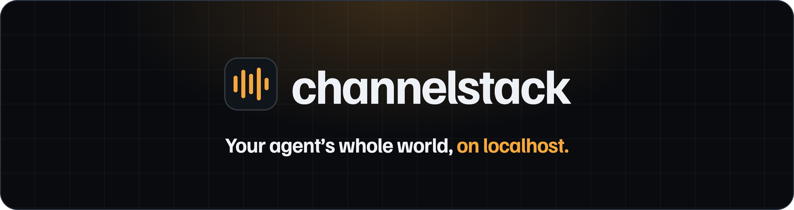
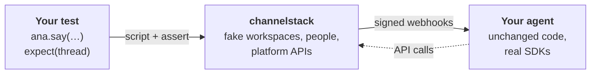

<p align="center">
  <a href="https://channelstack.dev">
    
  </a>
</p>

<p align="center">
  A test harness for AI agents that live in Slack, GitHub, Linear and Notion.
</p>

<p align="center">
  <a href="https://channelstack.dev">Website</a> ·
  <a href="https://channelstack.dev/docs">Docs</a> ·
  <a href="#status">Status</a> ·
  <a href="docs/phases.md">Build plan</a>
</p>

---

> [!NOTE]
> channelstack is under construction and not on npm yet. The server spine and the SDK generator are built; the fake platforms are not. This page describes how it will work. See [Status](#status).

channelstack runs fake versions of Slack, GitHub, Linear and Notion on your machine. Tests script the people, your agent answers through its real code path, and you assert on the conversation a person would see:

```ts
test("a mention gets exactly one reply, in the thread", async ({ slack }) => {
  const ana = await slack.createUser({ name: "Ana" });
  const channel = await slack.createChannel({ participants: [ana, slack.app] });

  const msg = await ana.say("@my-agent summarize yesterday's incidents", { channel });

  await expect(msg.thread).toHaveRepliesFrom("my-agent", { count: 1 });
  await expect(channel).not.toHaveChannelMessageFrom("my-agent");
});
```

There are no hand-built webhook payloads and no mocked SDK calls. Ana posts, the fake Slack delivers a signed event to your agent, your agent replies through the Slack SDK it already uses, and the matcher waits for what Ana would see in the thread.

## Why

Chat agents break in the gaps between systems: a webhook signed the wrong way, a payload shape that changed last month, a stray progress message nobody asserted on.

- **Your agent's real code path.** `channelstack env` prints the URLs and tokens that point your agent's own SDKs at `slack.localhost`, `github.localhost`, `linear.localhost` and `notion.localhost`. Agents that can't change their base URL send their traffic through channelstack's proxy instead ([proxy mode](docs/devx.md#9-proxy-mode-for-agents-that-cant-change-their-base-url)).
- **Shapes checked against the real platforms.** channelstack's own tests validate what the fakes send against the platforms' published schemas (GitHub, Linear) and against recorded real traffic where no usable schema exists (Slack). When a platform changes, channelstack's build goes red, instead of your tests passing against a stale fake.
- **People, not payloads.** Write `ana.click("Approve", { message })` instead of hand-building a `block_actions` body. People post, reply, review, delegate and press Stop, with correct signatures, retries and delivery ids.
- **Assert what people see.** Streams, status lines, edits and ephemeral messages render into one transcript. `toHaveRepliesFrom(…, { count: 1 })` catches the double post.

## Channels

Each channel is a fixture your test receives by name (`async ({ slack, github }) => …`). Use one, or several when your agent spans them.

| Channel | In your test | What it fakes                                                                    |
| ------- | -------- | -------------------------------------------------------------------------------- |
| Slack   | `slack`  | DMs, mentions, threads, buttons and modals, streaming replies and the agent view |
| GitHub  | `github` | Apps and installations, issues and pull requests, reviews, check runs            |
| Linear  | `linear` | Teams and issues, delegation, agent sessions, activities and the Stop signal     |
| Notion  | `notion` | Pages and databases, comments and discussions, connections and webhooks          |

The same tests can also run against the real platforms in sandbox workspaces ([live mode](docs/live-mode.md)).

## How it works



One server process fakes the platforms in memory. Your test drives it through a control API, it delivers what the platform would deliver, and your agent talks to it as if it were the real thing. channelstack never starts or wraps your agent. More in [docs/architecture.md](docs/architecture.md).

## Quick start

Once the first release is out:

```bash
npm i -D channelstack
npx channelstack                          # first run: starts the local proxy, trusts its CA, writes channelstack.config.ts
npx channelstack env >> .env.local        # tokens and URLs for your agent
portless run my-agent pnpm dev            # your usual start command, reachable at https://my-agent.localhost
```

Add the plugin to your test runner and run your tests:

```ts
// vitest.config.ts
import { defineConfig } from "vitest/config";
import channelstack from "channelstack/vitest";

export default defineConfig({ plugins: [channelstack()] });
```

[docs/devx.md](docs/devx.md) covers the CLI, the config file, Jest and pytest, proxy mode and CI.

## Status

Under construction, phase by phase. Phase 0 (the server spine, the SDK generator, packaging) is merged ([#3](https://github.com/christian-bromann/channelstack/pull/3), tag `phase-0-done`); the Slack fake is next. [docs/phases.md](docs/phases.md) has the plan and the check that proves each phase is done.

## In this repository

| Path                                         | What it is                                                           |
| -------------------------------------------- | -------------------------------------------------------------------- |
| [`api/`](api/)                               | The public TypeScript API and the examples that are its acceptance tests |
| [`server/`](server/)                         | The server: control API and the fake platforms                       |
| [`codegen/`](codegen/), [`sdks/`](sdks/)     | The SDK generator and the SDKs it produces                           |
| [`website/`](website/)                       | [channelstack.dev](https://channelstack.dev)                          |
| [`docs/`](docs/)                             | Design documents: [how it's used](docs/devx.md), [how it works](docs/architecture.md), [the build plan](docs/phases.md) |
| [`AGENTS.md`](AGENTS.md)                     | Start here if you're implementing channelstack                       |

## License

[MIT](LICENSE). channelstack is an independent project, not affiliated with or endorsed by Slack, GitHub, Linear or Notion.
